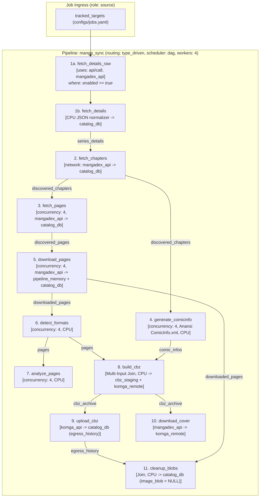

# MangaDex Catalog Ingestion & Synchronization Engine

> High-throughput, declarative, and memory-safe manga ingestion and packaging pipeline built on **Parabellum v2**.

---

## 1. Overview

`mangadex` synchronizes and archives manga series from the MangaDex API into ComicRack-compliant `.cbz` archives with Anansi `ComicInfo.xml` (v2.1) metadata, uploads them to Komga over SSH/SCP, triggers Komga library scans via REST, and caches catalog/page state in SQLite.

The application is orchestrated declaratively via [`configs/pipeline.yaml`](configs/pipeline.yaml) on the native Parabellum v2 runtime:

- **Declarative REST Datasources & `sdk.WebClient`**: `mangadex_api` ([`configs/api.mangadex.yaml`](configs/api.mangadex.yaml)) and `komga_api` ([`configs/api.komga.yaml`](configs/api.komga.yaml)) use the built-in `rest_api` driver and `api/call` builtin task.
- **Type-Driven Routing & Multi-Input Joins**: Uses `routing: type_driven` so steps bind dynamically via `canHandle()` and `inputFields()`, including multi-input Joins on `build_cbz` (`pages` + `comic_infos`) and `cleanup_blobs` (`egress_history` + `downloaded_pages`).
- **Least-Privilege Network Isolation**: Pure CPU tasks (`fetch_details`, `generate_comicinfo`, `detect_formats`, `analyze_pages`, `build_cbz`, `cleanup_blobs`) have no network access. Only I/O tasks bind explicitly to `mangadex_api` (rate-limited at 30 req/s, 60 burst) or `komga_api`.
- **Resilient Page Blob Persistence & Cleanup**: `download_pages` persists `image_blob`s into SQLite (`discovered_pages`); once `upload_cbz` confirms delivery (`egress_history`), `cleanup_blobs` clears `image_blob = NULL` (`status = 'cleaned'`) while preserving metadata.
- **Observability (OTEL & JSONL Tracing)**: Configured declaratively under `extensions:` (`opentelemetry` and `trace_jsonl`) via `.env` variables.
- **Unary Predicate Filtering**: Inbound jobs from `tracked_targets` (`jobs.yaml`) are filtered with `where: "enabled == true"` at `fetch_details_raw`.

---

## 2. DAG Topology & Dataflow



### Routing & Lifecycle Highlights
1. **`fetch_details_raw` -> `fetch_details`**: `api/call` fetches `/manga/{series_id}` and forwards the response body merged with job fields (`languages`, `chapters`, `library`) into the pure CPU parser.
2. **`build_cbz`**: Joins `pages` and `comic_infos`, writes backup `.cbz` archives to `cbz_staging` (`file_store`) and uploads in-memory `.cbz` archives to `komga_remote` (`ssh_store`).
3. **`upload_cbz` & `download_cover`**: Scans/analyzes the series in Komga (`komga_api`), records `egress_history` in `catalog_db`, and uploads `cover.{ext}` / `chapter_{chapter_number}.{ext}` to `komga_remote`.
4. **`cleanup_blobs`**: Joins `egress_history` (`status == "delivered"`) with `downloaded_pages` and upserts `discovered_pages` with `image_blob = NULL` and `status = "cleaned"`.

---

## 3. Execution Modes

### Offline Batch CLI (`run_pipeline.sh`)
Executes the pipeline against enabled targets in [`configs/jobs.yaml`](configs/jobs.yaml):

```bash
# Build (if needed), validate, and run offline batch
./run_pipeline.sh

# Force rebuild before running
./run_pipeline.sh --build

# Target a custom pipeline file
./run_pipeline.sh -p configs/custom_pipeline.yaml
```

### Pre-Flight Validation (`--validate`)
Validates YAML schemas, plugin ABI linkage, datasources, and DAG structure without executing tasks:

```bash
./run_pipeline.sh --validate
```

### Standalone Daemon / Server (`--serve`)
Runs Parabellum as a persistent daemon:

```bash
./run_pipeline.sh --serve
```

---

## 4. Configuration & Environment Reference

### Configuration Files
- [`configs/pipeline.yaml`](configs/pipeline.yaml): Extensions, datasources, egress networks, and pipeline steps.
- [`configs/jobs.yaml`](configs/jobs.yaml): Tracked manga targets, languages, chapter filters, and `enabled` flags.
- [`configs/schemas.yaml`](configs/schemas.yaml): SQLite table schemas (`catalog_series`, `discovered_chapters`, `discovered_pages`, `egress_history`).
- [`configs/api.mangadex.yaml`](configs/api.mangadex.yaml): Declarative MangaDex REST API endpoints.
- [`configs/api.komga.yaml`](configs/api.komga.yaml): Declarative Komga REST API endpoints.

### Environment Variables (`.env`)
| Variable | Description | Default |
| :--- | :--- | :--- |
| `MANGADEX_ACCESS_TOKEN` | Optional OAuth2 token for MangaDex API | `""` |
| `MANGADEX_USER_AGENT` | Custom User-Agent header for requests | `VidsecMangaDex/3.0.0` |
| `MANGADEX_DB_PATH` | Path to the SQLite catalog database | `./output/mangadex.db` |
| `CBZ_STAGING_DIR` | Local backup directory for generated `.cbz` files | `./output/cbz/` |
| `KOMGA_SSH_HOST` | Remote Komga SSH host | `localhost` |
| `KOMGA_SSH_DIR` | Remote Komga media root directory | `/data/komga` |
| `KOMGA_DEFAULT_LIBRARY` | Default Komga library name | `Manga` |
| `KOMGA_API_URL` | Komga REST API base URL | `http://127.0.0.1:25600` |
| `KOMGA_API_KEY` | Komga `X-API-Key` header | `""` |
| `OTEL_EXPORTER_FILE_PATH` | Output file for `opentelemetry` span logs | `./output/logs/otel_export.log` |
| `OTEL_LOG_CONSOLE` | Mirror all OTEL spans to stderr (`true`/`false`) | `false` |
| `PARABELLUM_TRACE_OUT` | Output file for `trace_jsonl` events | `./output/logs/trace.jsonl` |

---

## 5. Development & Testing

```bash
cd mangadex
zig build
zig build test --summary all
```
